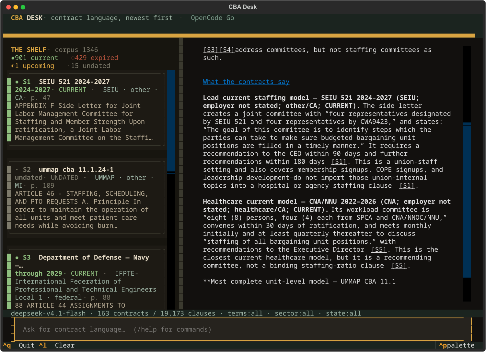

# CBA Desk

A collective-bargaining-agreement research chatbot. Ask for clause language,
get answers grounded in the contract text, with every source shown. It
**prioritizes recency**: current agreements outrank expired ones, and when the
same subject appears in several contracts the newest current agreement leads.

> Contract research, not legal advice.



```
┌ CBA DESK  contract language, newest first ───────────────────────────────┐
│ THE SHELF  · corpus 1,346      │  Ask for contract language…          │
│ ● 925 current  ○ 405 expired   │                                      │
│ ┌ S1  SEIU 1000 — State of CA ─┐  │  **What the contracts say**          │
│ │ 2024–2028  CURRENT  SEIU/CA  │  │  Current agreements cap arbitration  │
│ │ "The parties shall submit…"  │  │  fees at … [S1]                     │
│ └──────────────────────────────┘  │                                      │
└──────────────────────────────────────────────────────────────────────────┘
```

## Quick start

```bash
uv venv --python 3.12 .venv
uv pip install --python .venv/bin/python -e .
source .venv/bin/activate

cba-bot config --set-key sk-…       # OpenCode Go API key
cba-bot scrape --limit 150          # pull current CBAs from public collections
cba-bot index --limit 300           # extract, chunk, embed the newest 300
cba-bot                             # open the TUI
```

`index --limit 300` is a fast first pass: those are the current agreements, which
are the ones the recency model favors. Run `cba-bot index` again later (without
`--rebuild`) to add the older agreements incrementally.

One-shot mode:

```bash
cba-bot ask "Draft a remote-work clause for a public-sector unit"
cba-bot ask --fresh --sector education "How are class-size caps enforced?"
```

## Recency model

Each agreement gets an effective date, an expiry date, and a status
(`current`, `upcoming`, `expired`, `undated`). Metadata comes from source
manifests first; filenames are the fallback. Retrieval fuses BM25 and dense
results with reciprocal-rank fusion, then multiplies the score by a bounded
recency prior:

| Status | Weight |
| --- | --- |
| current | 0.75 – 1.00 (decays over ~4 years) |
| upcoming | 0.90 |
| expired | 0.40 – 0.45 |
| undated | 0.62 |

Expired agreements stay searchable (they are useful models) but need to be
clearly more on-point to outrank a current one. The answer prompt requires the
model to label older language as older/expired and never imply it is in force.
`/fresh` (or `--fresh`) removes expired agreements entirely.

## Corpus

Local PDFs/DOCX already in `contracts/` are indexed in place. Scrapers write to
`contracts/scraped/<source>/` and record metadata in
`contracts/manifests/<source>.jsonl`.

| Source | What it adds | Scope |
| --- | --- | --- |
| [Cornell eCommons](https://ecommons.cornell.edu/) | NY PERB + U.S. DOL historical CBA collections (DSpace API) | ~14,000 listed |
| [eScholarship UC IIR](https://escholarship.org/uc/iir_library_contracts) | California labor contracts, 1987–2004 (GraphQL) | 135 |
| [DOL OLMS CBA Search](https://olmsapps.dol.gov/olpdr/) | Private/public CBAs filed with OLMS | 4,850 |
| [OPM CBA Database](https://www.opm.gov/policy-data-oversight/labor-relations/collective-bargaining-agreements/) | Federal-sector agreements | 1,248 |
| [SeeThroughNY Contracts](https://seethroughny.net/contracts/) | NY municipal, school, police, fire agreements | 18,670 |
| [NY OER State Contracts](https://oer.ny.gov/state-union-contracts) | NY state union agreements | 15 |
| [NYC OLR](https://www.nyc.gov/site/olr/labor/labor-recent-agreements.page) | NYC municipal agreements | ~95 |
| [WA OFM](https://ofm.wa.gov/hr-policies/labor-relations/collective-bargaining-agreements/) | Washington state agreements | ~20 |
| San Francisco / Sonoma County | California city and county MOUs | 43 |
| St. Paul / Minneapolis / Boston | Minnesota and Massachusetts city agreements | 71 |
| Oregon / Illinois / Maryland / Wisconsin / Maine | State agreements reached through the AFSCME state-portal directory | 103 |

`--limit` (default 150) takes the newest documents per source, so a first build
is a few hundred to ~1,000 contracts; `--full` walks the entire source. The
AFSCME staff page is a directory of state portals with no documents of its own,
so the corpus follows its links to the portals that publish PDFs directly
(Oregon, Illinois, Maryland, Wisconsin, Maine). All scraped sources are U.S.
federal, state, or municipal agreements.

## Commands

| Command | Purpose |
| --- | --- |
| `cba-bot` / `cba-bot chat` | TUI |
| `cba-bot ask "…"` | one-shot answer |
| `cba-bot scrape [-s cornell,opm,ny,…] [--limit N] [--full]` | download CBAs |
| `cba-bot index [--rebuild] [--limit N]` | extract, chunk, embed |
| `cba-bot stats` | corpus + index counts |
| `cba-bot compact` | drop orphaned vectors from interrupted runs |
| `cba-bot models` | OpenCode Go model list |
| `cba-bot config --show` | paths and settings |

TUI commands: `/fresh`, `/sector`, `/state`, `/sources`, `/open N`, `/model`,
`/stats`, `/clear`, `/help`.

## How it works

- PDFs: PyMuPDF text layer; sparse pages fall back to `tesseract` OCR.
  DOCX: `python-docx`.
- Chunks: paragraph/sentence-aware, ~1,800 characters with 250-character
  overlap, page numbers preserved. Scanned pages are OCR'd with at most 30
  pages per document, so a 300-page scan cannot stall a build.
- Index: SQLite FTS5 (porter) for lexical search plus a float32 vector file for
  dense search (`sentence-transformers/all-MiniLM-L6-v2` via fastembed). No server.
- LLM: OpenCode Go, OpenAI-compatible endpoint
  (`https://opencode.ai/zen/go/v1`), default `deepseek-v4.1-flash`. A stable
  `x-opencode-session` header is sent per conversation for routing/caching.

## Tests

```bash
.venv/bin/python -m pytest
```

## License note

The original code is MIT. PDF extraction uses **PyMuPDF**, which is
AGPL-3.0; if you distribute a built binary or expose this as a network
service, review PyMuPDF's AGPL obligations or swap the extractor for a
permissive one (`pypdf`/`pdfplumber`) first.
